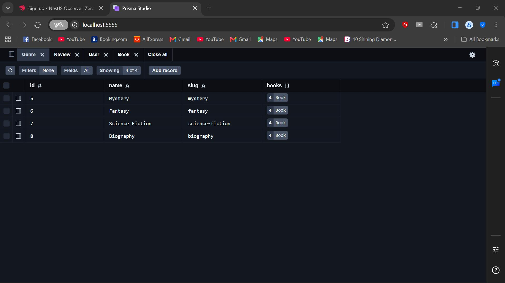
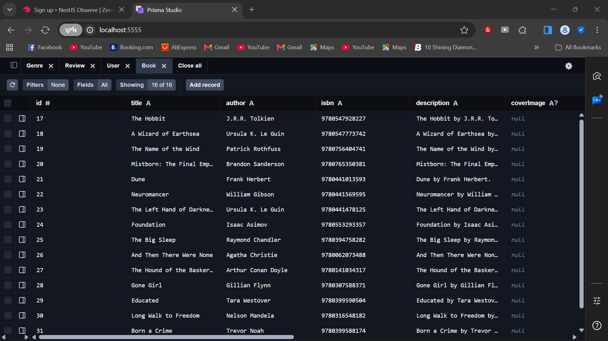
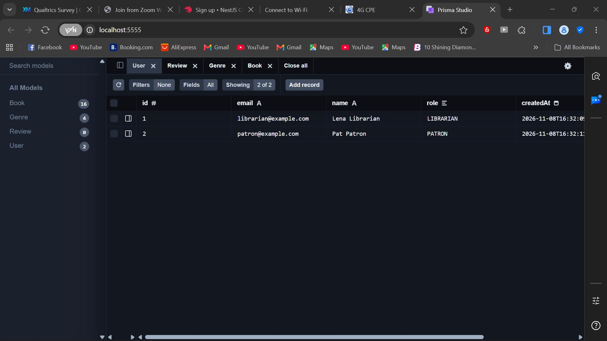
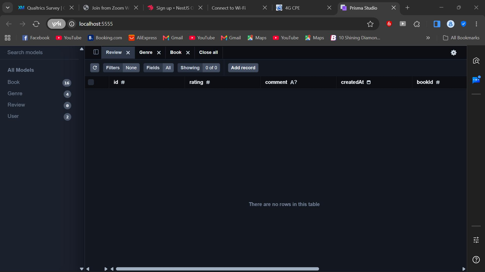

# library-management-system

A library catalog API built with NestJS, Prisma and PostgreSQL (hosted on Neon).

## Setup

1. `cd api`
2. `npm install`
3. Copy `.env.example` to `.env` and set your own `DATABASE_URL`
4. `npx prisma migrate dev`
5. `npx prisma db seed`
6. `npm run start`

## Schema Decisions

**Why `Book` references `Genre` instead of embedding it**

Each `Book` stores a `genreId` foreign key (with a Prisma `@relation`) pointing to a single row in the `Genre` table, rather than copying the genre's details into every book. Many books share one genre, and genres are managed independently, so renaming a genre should not require updating every book.

- **One source of truth.** A genre is defined once. Renaming it is a single-row update, not an edit to every book.
- **No inconsistency.** Embedded strings drift ("Sci-Fi", "SciFi", "science fiction"). A foreign key guarantees every book points to a genre that really exists.
- **Genres are queried on their own.** "List all genres" and "all books in a genre" are simple indexed queries.
- **Genres carry their own data.** A genre has its own attributes (such as a `slug`) without bloating every book record.

**Why `User` uses a `Role` enum**

`User` stores a `role` field using a `Role` enum (`PATRON` or `LIBRARIAN`), so both Postgres and TypeScript reject any other value. It defaults to `PATRON`, so new accounts get the lowest privilege.

**Review model (stretch)**

`Review` links a `Book` and a `User` with a `rating` and optional `comment`. A unique constraint on `bookId` and `userId` means each user can review a book only once.

**Prisma vs. a document database**

In a document database like MongoDB I would likely have embedded the genre inside each book for single-read convenience. In Prisma with PostgreSQL, the schema pushes me to normalize, and the database enforces the relation. Fetching a book with its genre needs an explicit `include: { genre: true }`, but in return I get integrity and consistent data.

## Screenshots

Screenshots of the seeded database in Prisma Studio.

**Genre table (4 genres)**

**Book table (16 books, each linked to a genre via `genreId`)**

**User table (one librarian, one patron)**

**Review table (stretch task)**

