# library-management-system

A library catalog built with NestJS, Prisma, PostgreSQL (hosted on Neon) and React. The API provides catalog CRUD for books and genres, search, sorting and pagination, and JWT authentication with role-based access control. The React client lets patrons browse, filter, search and sort the catalog.

## Setup

1. `cd api`
2. `npm install`
3. Copy `.env.example` to `.env` and set your own values:
   - `DATABASE_URL`: your PostgreSQL connection string
   - `JWT_SECRET`: a long random string, for example from `node -e "console.log(require('crypto').randomBytes(32).toString('hex'))"`
4. `npx prisma migrate dev`
5. `npx prisma db seed`
6. `npm run start:dev` (the API runs on `http://localhost:3000`)

The seed creates 4 genres, 16 books and two sample accounts (password `Password123!` for both, sample data only):

| Email | Role |
|---|---|
| `librarian@example.com` | LIBRARIAN |
| `patron@example.com` | PATRON |

## API Endpoints

| Method | Route | Access | Description |
|---|---|---|---|
| POST | `/auth/register` | Public | Create a PATRON account, returns a JWT |
| POST | `/auth/login` | Public (rate-limited) | Returns a JWT |
| GET | `/users/profile` | Logged in | The authenticated user's profile |
| GET | `/genres` | Public | List genres with book counts |
| GET | `/genres/:id` | Public | One genre |
| POST | `/genres` | Public | Create a genre |
| PATCH | `/genres/:id` | Public | Update a genre |
| DELETE | `/genres/:id` | Public | Delete a genre (blocked if it still has books) |
| GET | `/books` | Public | List books with filtering, search, sorting and pagination |
| GET | `/books/:id` | Public | One book |
| POST | `/books` | LIBRARIAN | Create a book |
| PATCH | `/books/:id` | LIBRARIAN | Update a book |
| DELETE | `/books/:id` | LIBRARIAN | Delete a book |

### Filtering, search, sorting and pagination

`GET /books` accepts these query parameters:

| Parameter | Description |
|---|---|
| `genreId` | Only books in this genre |
| `search` | Case-insensitive match on title or author |
| `sortBy` | `title`, `author`, `isbn`, `totalCopies` or `availableCopies` (default: oldest id first) |
| `page` | Page number (default 1) |
| `limit` | Books per page (default 10, maximum 100) |

Example: `GET /books?genreId=10&search=wizard&sortBy=title&page=1&limit=5`. The response contains `data` (the books, each with its genre) and `meta` (`total`, `page`, `limit`, `totalPages`). An unknown `sortBy` value is ignored.

## Authentication and Authorization

- **Registration and login** issue a JWT signed with `JWT_SECRET` (valid for one day). Send it as `Authorization: Bearer <token>`.
- **Passwords** are hashed with bcrypt before they are saved. They are never returned by the API.
- **Roles:** `JwtAuthGuard` verifies the token, then `RolesGuard` checks `req.user.role` against the roles named in `@Roles()`. Creating, updating and deleting books requires the `LIBRARIAN` role. A missing or invalid token returns 401, and a valid token with the wrong role returns 403.
- **Safe registration:** `/auth/register` always creates a `PATRON`. The role field is stripped by the global `ValidationPipe` (`whitelist: true`), so nobody can register themselves as a librarian.
- **Rate limiting:** `/auth/login` allows 5 attempts per minute per IP (`@nestjs/throttler`) and then returns 429.
- **Validation:** DTOs use `class-validator` on every field, and invalid input returns 400 with a list of messages.

## Postman Collection

Import `docs/postman_collection.json` into Postman. It has a request for every endpoint. Run **Login (librarian)** first, because it stores the token used by the other requests. **Create genre** and **Create book** store the ids used by the update and delete requests.

## Client

The patron-facing catalog is a React app built with Vite, Tailwind CSS, React Router and axios.

To run it:

1. Start the API: `cd api`, then `npm run start:dev`
2. In a second terminal: `cd client`, `npm install`, `npm run dev`
3. Open `http://localhost:5173`

`client/.env` holds `VITE_API_URL`, the address of the API (default `http://localhost:3000`). Vite reads it when the dev server starts, so restart `npm run dev` after changing it.

**Pages and components**

| File | Role |
|---|---|
| `src/main.jsx` | Wraps `<App />` in `<BrowserRouter>` |
| `src/App.jsx` | Routes for `/` and `/books/:id` |
| `src/pages/HomePage.jsx` | Holds the shared filter state (genre, search, sort) and renders the search bar, sort control, genre filter and book grid |
| `src/pages/BookDetail.jsx` | Reads the id with `useParams()` and fetches `GET /books/:id` |
| `src/components/BookGrid.jsx` | Fetches `GET /books` with the filters, with loading, error and empty states and pagination |
| `src/components/BookCard.jsx` | One book in the grid, linking to its detail page |
| `src/components/BookCover.jsx` | A generated cover coloured by genre, or the cover image if the book has one |
| `src/components/SearchBar.jsx` | Debounces input with `setTimeout` and a cleanup function before calling `onSearch` |

**Behaviour**

- **Search:** waits 400 ms after the last keystroke before it queries the API, so typing a word sends one request instead of one per letter.
- **Genre filter and sort:** changing either one returns the grid to page 1.
- **Stale responses:** each request is cancelled with an `AbortController` when the filters change, so a slow response can never overwrite a newer one.
- **States:** a skeleton grid while loading, an error message with a "Try again" button when the API is unreachable, and an empty message when nothing matches.
- **Detail page:** shows the title, author, genre, ISBN, availability and description, and a missing book shows a clear message.

## Schema Decisions

**Why `Book` references `Genre` instead of embedding it**

Each `Book` stores a `genreId` foreign key (with a Prisma `@relation`) pointing to a single row in the `Genre` table, rather than copying the genre's details into every book. Many books share one genre, and genres are managed independently, so renaming a genre should not require updating every book.

- **One source of truth.** A genre is defined once. Renaming it is a single-row update, not an edit to every book.
- **No inconsistency.** Embedded strings drift ("Sci-Fi", "SciFi", "science fiction"). A foreign key guarantees every book points to a genre that really exists.
- **Genres are queried on their own.** "List all genres" and "all books in a genre" are simple indexed queries.
- **Genres carry their own data.** A genre has its own attributes (such as a `slug`) without bloating every book record.

**Why `User` uses a `Role` enum**

`User` stores a `role` field using a `Role` enum (`PATRON` or `LIBRARIAN`), so both Postgres and TypeScript reject any other value. It defaults to `PATRON`, so new accounts get the lowest privilege.

**Review model (stretch)**

`Review` links a `Book` and a `User` with a `rating` and optional `comment`. A unique constraint on `bookId` and `userId` means each user can review a book only once.

**Prisma vs. a document database**

In a document database like MongoDB I would likely have embedded the genre inside each book for single-read convenience. In Prisma with PostgreSQL, the schema pushes me to normalize, and the database enforces the relation. Fetching a book with its genre needs an explicit `include: { genre: true }`, but in return I get integrity and consistent data.

## Screenshots

Screenshots of the seeded database in Prisma Studio.

**Genre table (4 genres)**

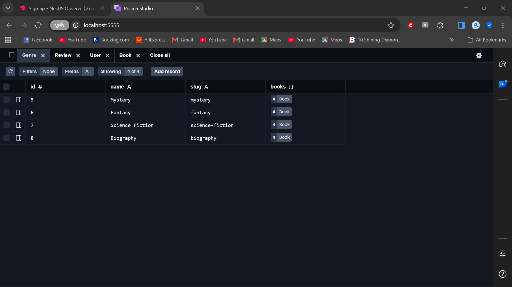

**Book table (16 books, each linked to a genre via `genreId`)**

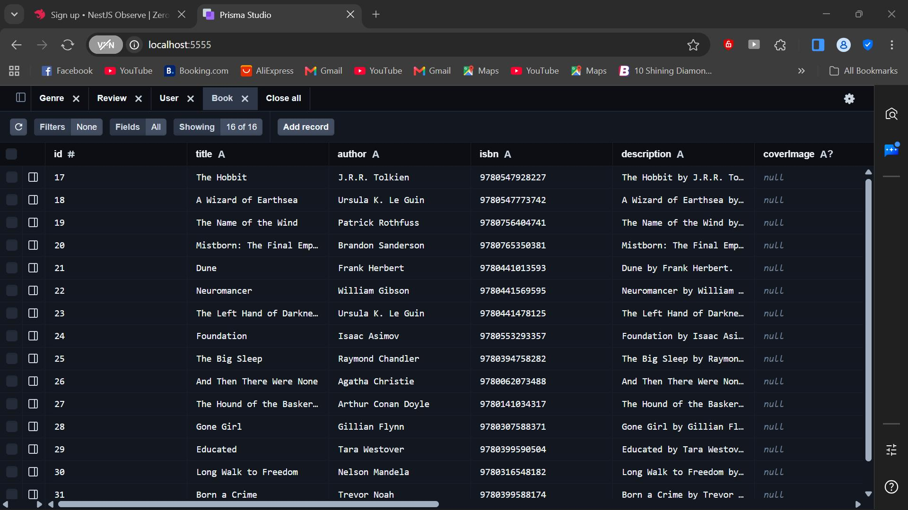

**User table (one librarian, one patron)**

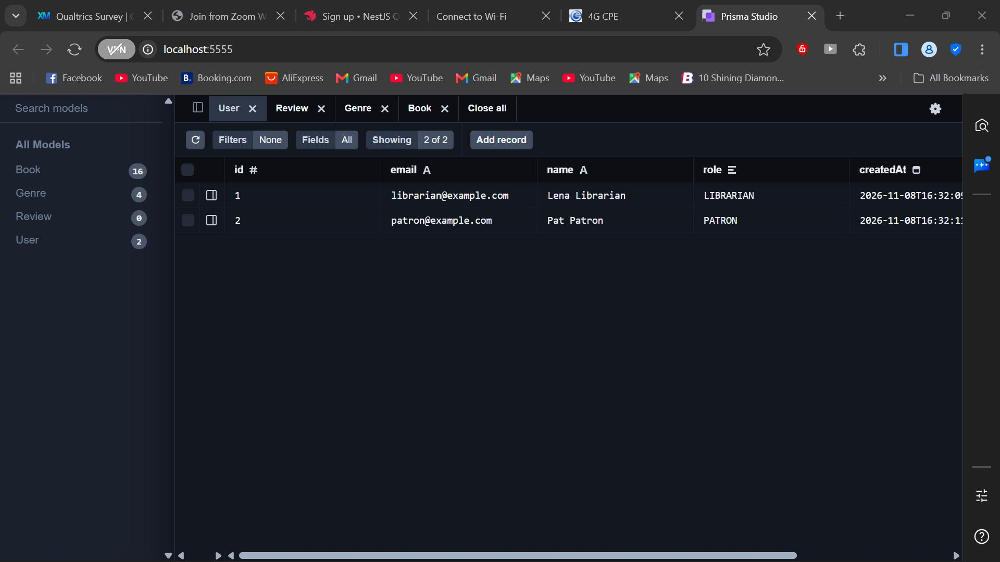

**Review table (stretch task)**

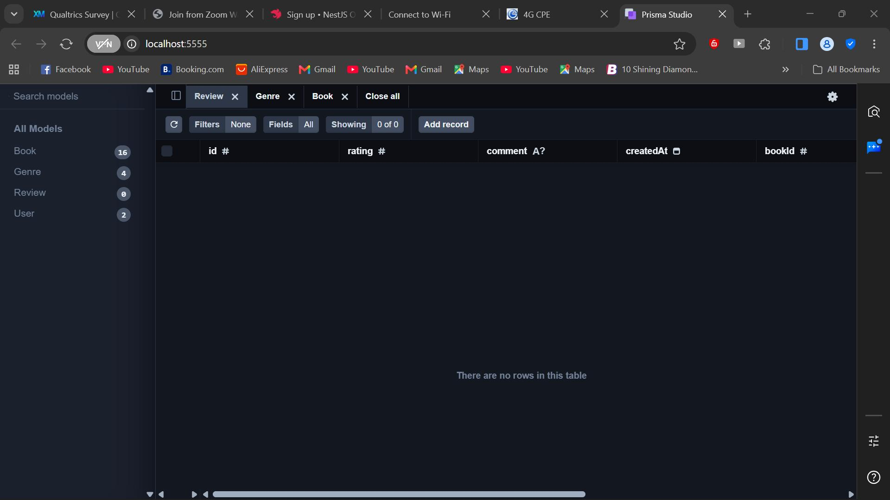

### Client (React catalog)

Screenshots of the catalog running against the live API.

**The full catalog: all 16 books, sorted by title**

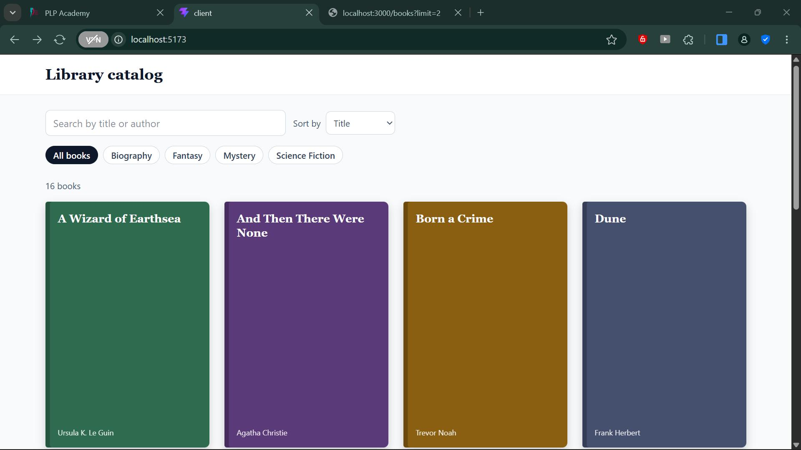

**Genre filter: Biography**

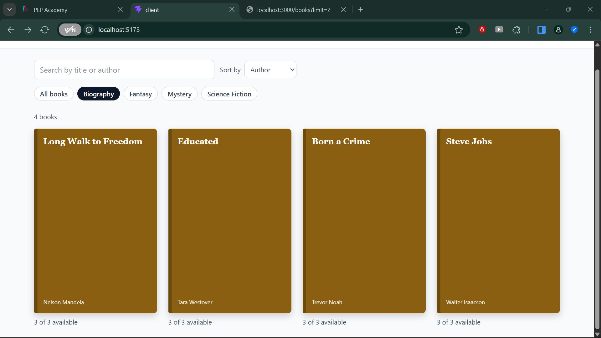

**Genre filter: Fantasy**

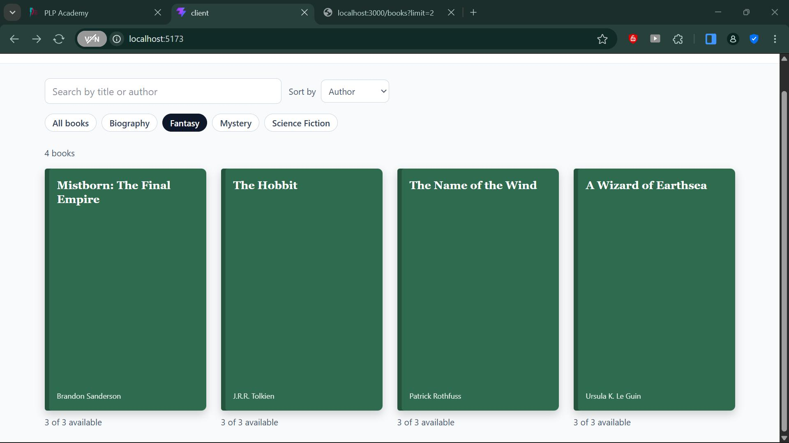

**Genre filter: Mystery**

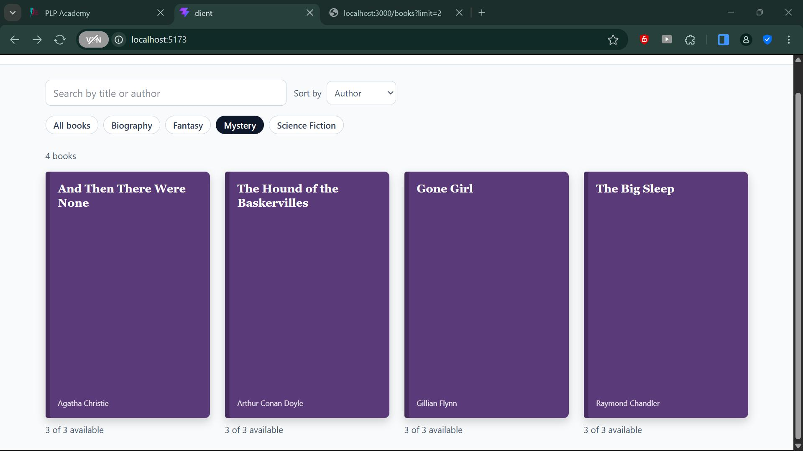

**Sort by newest first (the default order)**

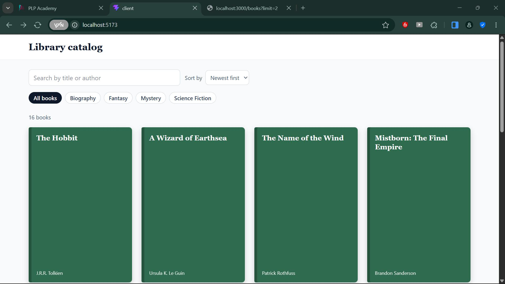

**Sort by title**

**Sort by author, filtered to Science Fiction**

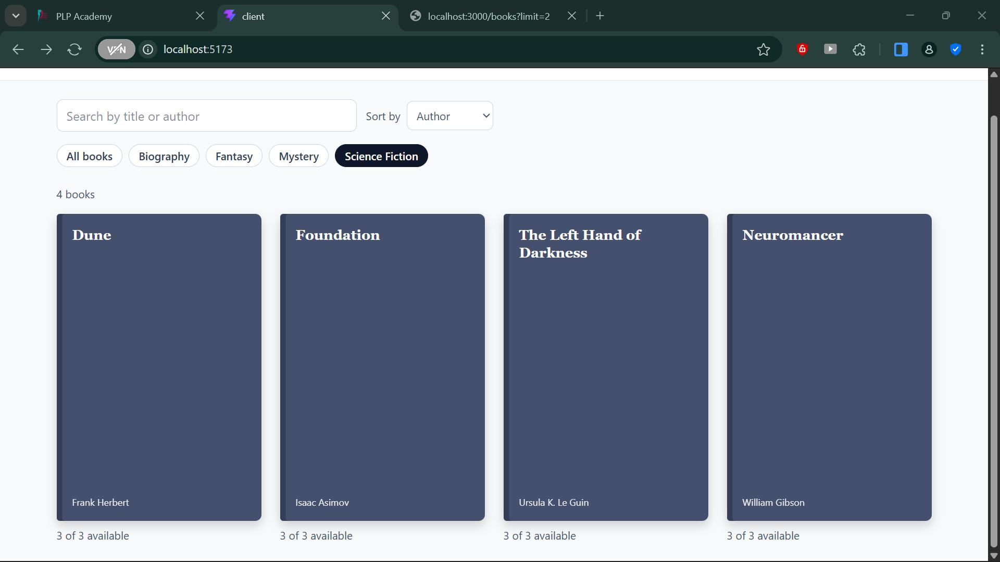

**Pagination: page 1 of 2**

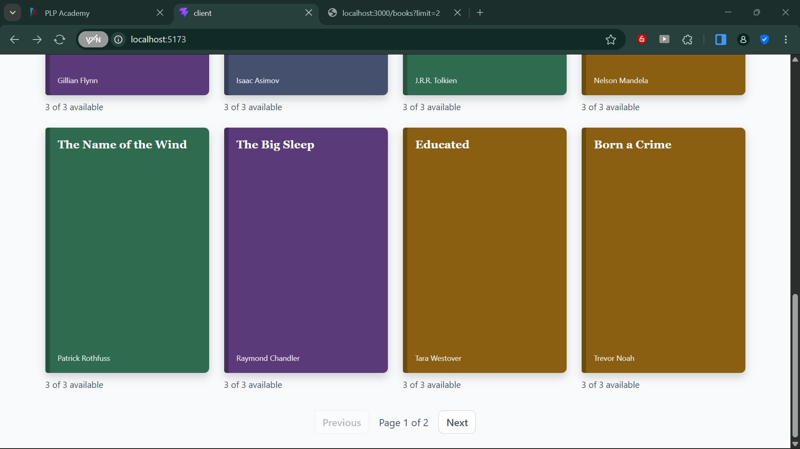

**Pagination: page 2 of 2**

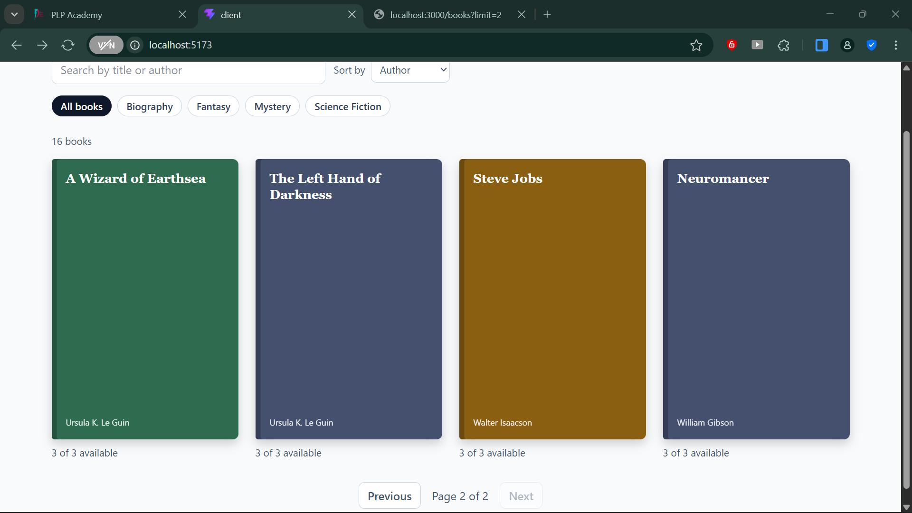